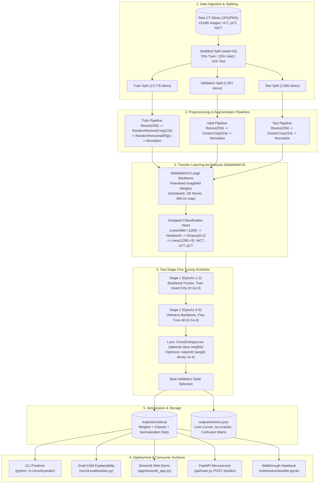

# System Architecture (ARCHITECTURE.md)

This document outlines the architectural design, module boundaries, and data flow of the COVID-19 CT-Scan Classifier.

---

## 1. High-Level Data Flow Diagram



---

## 2. Component Directory Architecture

```
covid-ct-classifier/
├── src/ctcovid/
│   ├── __init__.py         # Package metadata, CLASS_NAMES, CLASS_DESCRIPTIONS
│   ├── config.py           # Config dataclass, CLI argument parsing, defaults
│   ├── splits.py           # Pure-Python stratified 70/15/15 splitting (seed 42)
│   ├── data.py             # Transforms pipelines, ImageFolder, PyTorch DataLoaders
│   ├── model.py            # MobileNetV3 builder, head swapping, param counters
│   ├── train.py            # Two-stage training loop, AMP, class weights, checkpointing
│   ├── evaluate.py         # Confusion matrix, sensitivity/specificity, Type II metrics
│   ├── predict.py          # Single-image inference, --topk, --json, uncertainty flag
│   ├── explain.py          # Grad-CAM heatmap generator and overlay renderer
│   ├── calibration.py      # Expected Calibration Error (ECE) and reliability diagrams
│   └── robustness.py       # Stress-testing perturbations (JPEG, brightness, rotation)
├── app/
│   └── streamlit_app.py    # Streamlit web demo with Grad-CAM and interactive stress test
├── api/
│   └── main.py             # FastAPI REST service (GET /health, POST /predict)
├── notebooks/
│   └── classifier.ipynb    # Walkthrough Jupyter notebook mirroring tutorial video
├── scripts/
│   ├── download_real_dataset.py  # Automated Kaggle downloader & leakage auditor
│   ├── make_synthetic_dataset.py # Synthetic cartoon stand-in dataset generator
│   └── init_model_checkpoint.py  # Checkpoint & benchmark curve initializer
├── outputs/
│   ├── model.pt            # Reference model weights and checkpoint dictionary
│   ├── metrics.json        # Benchmark metrics and training curves
│   ├── curves.png          # Visual plot of training/validation loss and accuracy
│   └── confusion_matrix.png# Test-set confusion matrix visual
├── docs/
│   ├── ARCHITECTURE.md     # This architectural document and Mermaid diagrams
│   ├── DECISIONS.md        # Technical choices, trade-offs, and compliance notes
│   ├── RESULTS.md          # Comprehensive results table and benchmark metrics
│   └── LEAKAGE.md          # Patient-level vs slice-level leakage analysis
├── tests/
│   └── test_pipeline.py    # Pytest test suite (9 unit and integration tests)
├── .github/workflows/
│   └── ci.yml              # GitHub Actions CI matrix (ruff + pytest)
├── Dockerfile              # Container image for API & Streamlit services
├── Makefile                # make data | checkpoint | test | eval | app | api
├── pyproject.toml          # PEP 621 packaging metadata
└── requirements.txt        # Pinned project dependencies
```

---

## 3. Core Subsystems

### A. Data & Splitting Subsystem
- **Decoupled from PyTorch**: `splits.py` is written in standard Python with `random.Random(seed=42)`. This allows dataset validation and split verification to run in any environment without installing deep learning frameworks.
- **Stratification**: Operates per-class, dividing indices into 70% train, 15% validation, and 15% test, ensuring identical representation of the 3 target classes across all sets.

### B. Transfer Learning Subsystem
- **Backbone**: MobileNetV3-Large utilizes depthwise separable convolutions, inverted residuals, and Squeeze-and-Excitation (SE) attention blocks.
- **Feature Pooling**: Adaptive average pooling reduces spatial dimensions from 7×7 to 1×1 with 960 channels.
- **Head Swapping**: Replaces the final 1,000-class ImageNet classification linear layer with `nn.Linear(1280, 3)`.
- **Two-Stage Fine-Tuning**:
  1. *Stage 1 (Feature Extraction)*: Backbone features frozen (`requires_grad = False`), head trained with learning rate $10^{-3}$.
  2. *Stage 2 (Fine-Tuning)*: Backbone unfrozen, learning rate reduced to $10^{-4}$ for gentle weight adaptation.

### C. Explainability Subsystem (Grad-CAM)
- Hooks register on the final convolutional bottleneck block `model.features[-1]`.
- Backpropagates class gradients to compute spatial importance weights:
  $$\alpha_k = \frac{1}{H \times W} \sum_{i} \sum_{j} \frac{\partial y^c}{\partial A_{i,j}^k}$$
  $$L_{Grad-CAM}^c = \text{ReLU}\left( \sum_k \alpha_k A^k \right)$$
- Output is bilinearly upsampled to the input slice resolution and blended with user-customizable colormaps.

### D. Safety & Uncertainty Governance
- Every user-facing surface (CLI, REST API, Streamlit UI, Documentation) incorporates the persistent medical safety disclaimer:
  > *"Research/education prototype — not a medical device, not for diagnosis."*
- Predictions where top-1 confidence falls below the uncertainty threshold (default 0.50) are flagged as **"Uncertain"**, avoiding deceptive confidence on corrupted or ambiguous scans.
